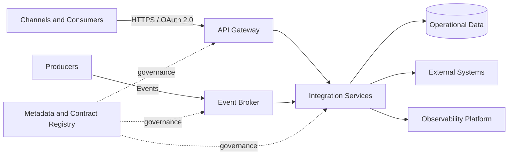
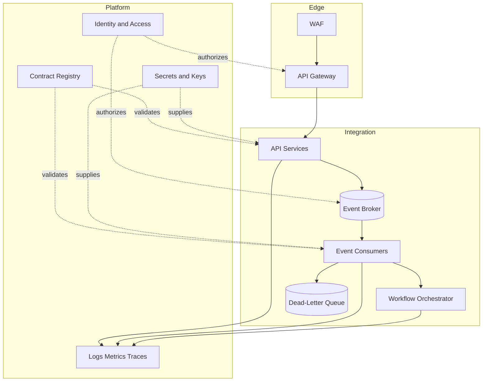
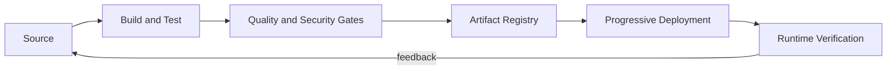

# High-Level Design: Cloud-Native Integration Platform

- **Status:** Reference architecture
- **Version:** 1.0
- **Audience:** Solution architects, platform engineers, security, operations, and delivery teams

## 1. Executive summary

This reference architecture provides a governed platform for synchronous APIs, asynchronous events, and long-running integration workflows. It separates business capabilities from transport technology and includes security, observability, resilience, and delivery controls by design.

The design is vendor-neutral. Product selections must be validated against organizational standards, workload characteristics, regulatory requirements, and total cost of ownership.

## 2. Scope

### In scope

- API and event-based integration
- Contract and schema governance
- Reliable message delivery and reconciliation
- Identity, secrets, encryption, and audit controls
- Centralized logs, metrics, traces, alerts, and SLOs
- Automated delivery through CI/CD and Infrastructure as Code

### Out of scope

- Organization-specific products or network topology
- Domain-specific business rules
- Sensitive or regulated production data
- Detailed sizing and commercial estimates

## 3. Architecture drivers

| Driver | Architecture response |
|---|---|
| Loose coupling | Events and queues for suitable flows |
| Immediate outcomes | Governed synchronous APIs |
| Traffic variability | Horizontal scaling and buffering |
| Reliability | Idempotency, retries, dead-letter handling, reconciliation |
| Traceability | Correlation IDs and distributed tracing |
| Security | Workload identity, least privilege, encryption, audit |
| Change safety | Versioned contracts, automated tests, progressive delivery |

## 4. System context

## 5. Logical containers

## 6. Component responsibilities

| Component | Responsibility |
|---|---|
| WAF | Protect public entry points and enforce edge controls |
| API Gateway | Authentication, routing, throttling, policy, and API analytics |
| API Services | Execute bounded synchronous business capabilities |
| Event Broker | Buffer, route, and decouple event producers and consumers |
| Event Consumers | Validate, deduplicate, and process messages idempotently |
| Workflow Orchestrator | Coordinate long-running processes, timeouts, and compensation |
| Contract Registry | Govern API specifications and event schemas |
| Identity and Access | Issue and validate workload and user identities |
| Secrets and Keys | Manage credentials, certificates, encryption keys, and rotation |
| Observability Platform | Centralize telemetry, dashboards, alerts, and evidence |

## 7. Primary flows

### Synchronous request

1. The consumer authenticates through the edge.
2. The gateway validates policy, quota, and route.
3. The API service validates the contract and authorization.
4. The service completes within the defined timeout or returns a controlled error.
5. Correlation identifiers and telemetry are recorded end to end.

### Asynchronous processing

1. The producer publishes a versioned event.
2. The broker persists and routes the message.
3. The consumer validates the schema and idempotency key.
4. Successful processing updates state and emits the next business event when required.
5. Exhausted retries move the message to a dead-letter queue for controlled recovery.

### Hybrid processing

1. The API validates and accepts a command.
2. The caller receives an acknowledgement and tracking identifier.
3. Processing continues asynchronously.
4. Completion is exposed through an event, callback, or status resource.

## 8. Data and consistency

- Assign a system of record to every business entity.
- Use eventual consistency only with explicit business acceptance.
- Use transactional outbox or an equivalent pattern when state and event publication must remain aligned.
- Define retention, replay, reconciliation, and deletion policies.
- Prevent sensitive data from propagating unnecessarily through events and logs.

## 9. Security architecture

- Use federated identity and short-lived credentials.
- Enforce least privilege for APIs, topics, queues, data stores, and pipelines.
- Encrypt traffic and persistent data with managed key rotation.
- Store secrets outside source code and deployment manifests.
- Record administrative and business-relevant audit events.
- Validate dependencies, containers, IaC, and application code in CI/CD.
- Model threats at trust boundaries and before material design changes.

## 10. Reliability and resilience

| Control | Expected behavior |
|---|---|
| Timeout | Bounded per dependency and business operation |
| Retry | Limited, exponential backoff with jitter |
| Idempotency | Required for retriable commands and messages |
| Circuit breaker | Protect unstable synchronous dependencies |
| Dead-letter handling | Owned queue, alert, triage, and replay procedure |
| Reconciliation | Detect and repair incomplete or inconsistent processing |
| Recovery | Tested backup, restore, RTO, and RPO procedures |

## 11. Observability and operations

- Propagate a correlation ID and W3C trace context across all hops.
- Measure request latency, throughput, errors, saturation, queue age, retries, and dead-letter volume.
- Define service-level indicators and objectives for critical flows.
- Alert on user impact and SLO risk rather than infrastructure thresholds alone.
- Maintain dashboards, runbooks, escalation paths, and named operational ownership.

## 12. Delivery and DevSecOps

The delivery pipeline must include contract validation, unit and integration tests, dependency scanning, static analysis, IaC validation, artifact signing where required, approval controls, rollback, and post-deployment verification.

## 13. Non-functional requirements

| Attribute | Reference target | Validation |
|---|---|---|
| Availability | Defined per business capability | Failure and recovery tests |
| API latency | Percentile-based SLO | Load and performance tests |
| Event processing | Maximum queue age and completion time | Volume and resilience tests |
| Recovery | Explicit RTO and RPO | Recovery exercise |
| Security | No critical unresolved findings | Security gates and review |
| Observability | End-to-end trace for critical flows | Synthetic transaction |

Targets must be replaced with workload-specific values during solution design.

## 14. Risks and mitigations

| Risk | Mitigation |
|---|---|
| Uncontrolled event proliferation | Domain ownership, registry, lifecycle policy |
| Retry storms | Backoff, jitter, limits, circuit breaking |
| Hidden eventual consistency | Explicit state model and reconciliation |
| Platform coupling | Ports, adapters, open contracts, exit strategy |
| Telemetry cost growth | Sampling, retention tiers, cardinality controls |
| Operational ownership gaps | Named service owner and runbook before production |

## 15. Related decisions

- [ADR-0001: Versioned architecture assets](../adr/ADR-0001-versioned-architecture-assets.md)
- [ADR-0002: Integration pattern selection](../adr/ADR-0002-integration-pattern-selection.md)

## 16. Architecture review exit criteria

The design is ready to progress when scope, ownership, contracts, NFR targets, security controls, failure behavior, observability, delivery approach, risks, and operational readiness have named owners and verifiable evidence.
