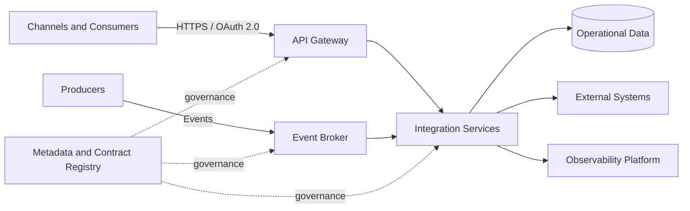
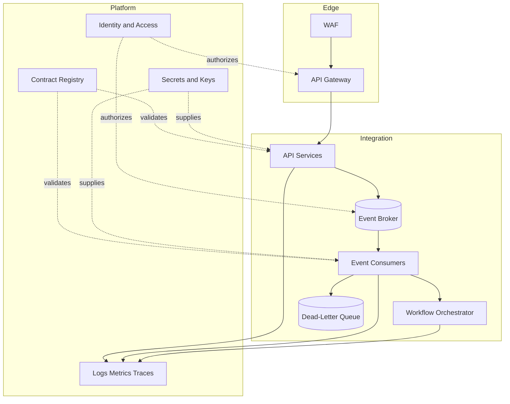
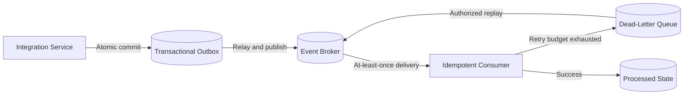
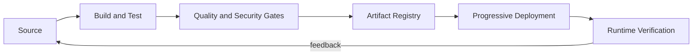

# High-Level Design: Cloud-Native Integration Platform

- **Status:** Reference architecture
- **Version:** 1.1
- **Audience:** Solution architects, platform engineers, security, operations, and delivery teams

## 1. Executive summary

This reference architecture provides a governed platform for synchronous APIs, asynchronous events, and long-running integration workflows. It separates business capabilities from transport technology and includes security, observability, resilience, and delivery controls by design.

The design is vendor-neutral. Product selections must be validated against organizational standards, workload characteristics, regulatory requirements, and total cost of ownership.

## 2. Scope

### In scope

- API and event-based integration
- Contract and schema governance
- Reliable message delivery and reconciliation
- Identity, secrets, encryption, and audit controls
- Centralized logs, metrics, traces, alerts, and SLOs
- Automated delivery through CI/CD and Infrastructure as Code

### Out of scope

- Organization-specific products or network topology
- Domain-specific business rules
- Sensitive or regulated production data
- Detailed sizing and commercial estimates

## 3. Architecture drivers

| Driver | Architecture response |
|---|---|
| Loose coupling | Events and queues for suitable flows |
| Immediate outcomes | Governed synchronous APIs |
| Traffic variability | Horizontal scaling and buffering |
| Reliability | Idempotency, retries, dead-letter handling, reconciliation |
| Traceability | Correlation IDs and distributed tracing |
| Security | Workload identity, least privilege, encryption, audit |
| Change safety | Versioned contracts, automated tests, progressive delivery |

## 4. System context

## 5. Logical containers

## 6. Component responsibilities

| Component | Responsibility |
|---|---|
| WAF | Protect public entry points and enforce edge controls |
| API Gateway | Authentication, routing, throttling, policy, and API analytics |
| API Services | Execute bounded synchronous business capabilities |
| Event Broker | Buffer, route, and decouple event producers and consumers |
| Event Consumers | Validate, deduplicate, and process messages idempotently |
| Workflow Orchestrator | Coordinate long-running processes, timeouts, and compensation |
| Contract Registry | Govern API specifications and event schemas |
| Identity and Access | Issue and validate workload and user identities |
| Secrets and Keys | Manage credentials, certificates, encryption keys, and rotation |
| Observability Platform | Centralize telemetry, dashboards, alerts, and evidence |

## 7. Primary flows

### Synchronous request

1. The consumer authenticates through the edge.
2. The gateway validates policy, quota, and route.
3. The API service validates the contract and authorization.
4. The service completes within the defined timeout or returns a controlled error.
5. Correlation identifiers and telemetry are recorded end to end.

### Asynchronous processing

1. The producer publishes a versioned event.
2. The broker persists and routes the message.
3. The consumer validates the schema and idempotency key.
4. Successful processing updates state and emits the next business event when required.
5. Exhausted retries move the message to a dead-letter queue for controlled recovery.

### Hybrid processing

1. The API validates and accepts a command.
2. The caller receives an acknowledgement and tracking identifier.
3. Processing continues asynchronously.
4. Completion is exposed through an event, callback, or status resource.

## 8. Data and consistency

- Assign a system of record to every business entity.
- Use eventual consistency only with explicit business acceptance.
- Use transactional outbox or an equivalent pattern when state and event publication must remain aligned.
- Define retention, replay, reconciliation, and deletion policies.
- Prevent sensitive data from propagating unnecessarily through events and logs.

## 9. Security architecture

- Use federated identity and short-lived credentials.
- Enforce least privilege for APIs, topics, queues, data stores, and pipelines.
- Encrypt traffic and persistent data with managed key rotation.
- Store secrets outside source code and deployment manifests.
- Record administrative and business-relevant audit events.
- Validate dependencies, containers, IaC, and application code in CI/CD.
- Model threats at trust boundaries and before material design changes.

## 10. Reliability and resilience

| Control | Expected behavior |
|---|---|
| Timeout | Bounded per dependency and business operation |
| Retry | Limited, exponential backoff with jitter |
| Idempotency | Required for retriable commands and messages |
| Circuit breaker | Protect unstable synchronous dependencies |
| Dead-letter handling | Owned queue, alert, triage, and replay procedure |
| Reconciliation | Detect and repair incomplete or inconsistent processing |
| Recovery | Tested backup, restore, RTO, and RPO procedures |

### Failure and recovery flow

The platform uses at-least-once delivery. It prevents event loss by committing the business change and its event in the same local transaction, and it prevents duplicate business effects through consumer idempotency. Exactly-once transport delivery is not assumed.

#### Failure behavior and recovery controls

| Scenario | Required behavior | Recovery and evidence |
|---|---|---|
| Broker unavailable before publication | The service commits the business state and event atomically to the outbox. The relay retains the pending record, retries with exponential backoff and jitter, and does not mark it as published until the broker acknowledges durable acceptance. | Alert on oldest pending outbox age and relay failures. Platform Operations restores broker connectivity; the relay resumes without a manual republish. |
| Duplicate delivery | The consumer checks a stable event identifier against its idempotency store in the same transaction as the business effect. A previously completed event is acknowledged without repeating the effect. | Record the duplicate outcome and correlation ID. The owning service team investigates abnormal duplicate rates. |
| Transient consumer failure | The broker or consumer retries only errors classified as retriable, using bounded exponential backoff with jitter. Each service must define a maximum attempt count and maximum retry window before production; undefined values are an architecture-review blocker. | Expose attempt count, next retry time, error category, event ID, and correlation ID in telemetry. |
| Permanent or exhausted failure | A non-retriable contract, authorization, or validation failure, or exhaustion of the configured retry budget, sends the original event and failure metadata to the DLQ. | Alert immediately for critical business flows and on DLQ age or volume for all flows. The consumer owner leads triage. |
| Partial or inconsistent outcome | Reconciliation compares the producer system of record, outbox publication state, broker evidence, idempotency records, and consumer state. | The business process owner confirms the intended outcome; the service owner repairs or compensates it using an auditable operation. |

#### DLQ triage and replay procedure

1. The on-call responder acknowledges the alert and identifies the affected event, correlation ID, consumer, error category, and retry history.
2. The consumer owner determines the root cause and classifies the event as recoverable, compensating, or permanently rejected.
3. The responsible team fixes the dependency, data, contract, configuration, or code issue and validates the correction outside production.
4. An authorized operator records the change or incident reference and approves replay. Bulk replay requires change control and rate limiting.
5. Replay preserves the original event identifier, payload, schema version, and correlation context. The idempotent consumer ensures an already completed business effect is not repeated.
6. After replay, the service owner confirms successful processing, and the business process owner performs reconciliation against the system of record.
7. The DLQ item is closed only after processing evidence and reconciliation results are retained for audit.

DLQ messages must not be edited in place. If correction is required, create a new, traceable event that references the failed event and follows the normal authorization and validation path.

#### Operational ownership

| Activity | Accountable role | Required outcome |
|---|---|---|
| Alert definition and routing | Platform Operations / SRE | Actionable alerts for outbox age, relay failures, retry exhaustion, DLQ depth and age, and reconciliation gaps |
| Broker and relay recovery | Platform Operations / SRE | Broker availability restored and pending outbox records drained safely |
| Consumer triage and defect correction | Owning service team | Root cause removed and replay readiness demonstrated |
| Replay authorization and execution | Service owner and authorized operator | Controlled replay with audit evidence and rate limits |
| Business reconciliation | Business process owner with service owner | System-of-record and downstream outcomes agree, or an approved compensation is completed |

A flow is considered recovered only when pending outbox records are published, the broker backlog is within its workload-specific objective, replayed events are processed or explicitly rejected, and reconciliation shows no unexplained missing or duplicate business effects.

## 11. Observability and operations

- Propagate a correlation ID and W3C trace context across all hops.
- Measure request latency, throughput, errors, saturation, queue age, retries, and dead-letter volume.
- Define service-level indicators and objectives for critical flows.
- Alert on user impact and SLO risk rather than infrastructure thresholds alone.
- Maintain dashboards, runbooks, escalation paths, and named operational ownership.

## 12. Delivery and DevSecOps

The delivery pipeline must include contract validation, unit and integration tests, dependency scanning, static analysis, IaC validation, artifact signing where required, approval controls, rollback, and post-deployment verification.

## 13. Non-functional requirements

| Attribute | Reference target | Validation |
|---|---|---|
| Availability | Defined per business capability | Failure and recovery tests |
| API latency | Percentile-based SLO | Load and performance tests |
| Event processing | Maximum queue age and completion time | Volume and resilience tests |
| Recovery | Explicit RTO and RPO | Recovery exercise |
| Security | No critical unresolved findings | Security gates and review |
| Observability | End-to-end trace for critical flows | Synthetic transaction |

Targets must be replaced with workload-specific values during solution design.

## 14. Risks and mitigations

| Risk | Mitigation |
|---|---|
| Uncontrolled event proliferation | Domain ownership, registry, lifecycle policy |
| Retry storms | Backoff, jitter, limits, circuit breaking |
| Hidden eventual consistency | Explicit state model and reconciliation |
| Platform coupling | Ports, adapters, open contracts, exit strategy |
| Telemetry cost growth | Sampling, retention tiers, cardinality controls |
| Operational ownership gaps | Named service owner and runbook before production |

## 15. Related decisions

- [ADR-0001: Versioned architecture assets](../adr/ADR-0001-versioned-architecture-assets.md)
- [ADR-0002: Integration pattern selection](../adr/ADR-0002-integration-pattern-selection.md)

## 16. Architecture review exit criteria

The design is ready to progress when scope, ownership, contracts, NFR targets, security controls, failure behavior, observability, delivery approach, risks, and operational readiness have named owners and verifiable evidence.
