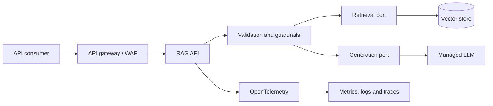
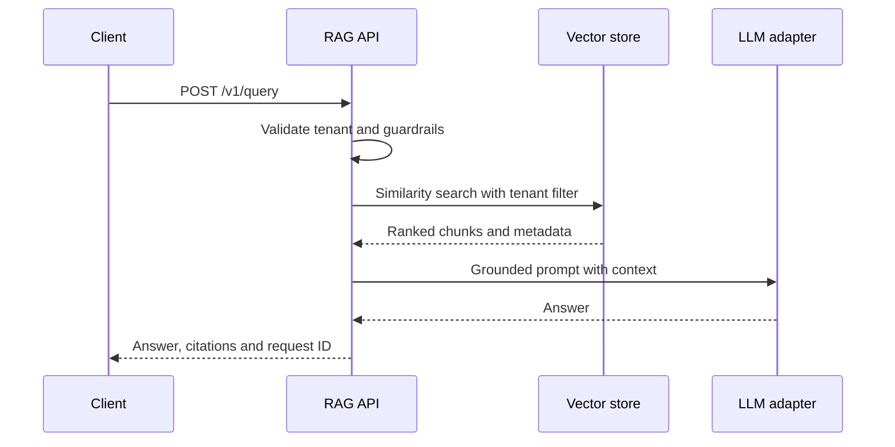

# Production RAG Platform Reference

Production-oriented reference implementation for a secure, observable and cloud-ready Retrieval-Augmented Generation platform. It demonstrates architecture decisions with executable code instead of presenting a vendor-specific demo.

> This repository is a reference implementation. The default RAG engine is deterministic and local so the project can be tested without credentials or paid APIs. Production adapters for a managed LLM and vector database belong behind the documented ports.

## What this proves

- Clean API boundaries for ingestion, retrieval and grounded answers.
- Tenant isolation at the application contract.
- Citations, input limits and basic prompt-injection guardrails.
- Health, readiness and Prometheus metrics endpoints.
- Non-root container and hardened Kubernetes workload.
- AWS foundation expressed as Terraform.
- OpenTelemetry collector configuration and SLO-oriented alerts.
- CI gates for tests, dependency audit, Terraform and configuration syntax.

## Architecture





## Repository map

| Path | Purpose |
|---|---|
| `app/` | FastAPI service, domain logic and tests |
| `infra/terraform/` | AWS VPC, encryption, artifact and logging foundation |
| `deploy/kubernetes/` | Hardened workload, autoscaling, disruption and network policies |
| `observability/` | OpenTelemetry pipeline and Prometheus alert rules |
| `docs/adr/` | Architecture decisions and trade-offs |
| `docs/runbooks/` | Operational response procedures |

## Run locally

```bash
cd app
python -m venv .venv
source .venv/bin/activate
python -m pip install --upgrade 'pip>=26.2'
python -m pip install -e '.[dev]'
uvicorn rag_platform.main:app --reload
```

Ingest and query:

```bash
curl -sS -X POST http://localhost:8000/v1/documents \
  -H 'Content-Type: application/json' \
  -d '{"tenant_id":"demo","documents":[{"id":"doc-1","text":"Zero Trust requires explicit verification and least privilege.","source":"security-standard.md"}]}'

curl -sS -X POST http://localhost:8000/v1/query \
  -H 'Content-Type: application/json' \
  -d '{"tenant_id":"demo","question":"What does Zero Trust require?","top_k":3}'
```

## Validate

```bash
cd app
python -m pip install -e '.[dev]'
pytest

cd ../infra/terraform
terraform fmt -check -recursive
terraform init -backend=false
terraform validate

cd ../..
docker build -f app/Dockerfile app
```

## Production gaps intentionally left as adapters

The repository does not pretend to deploy a complete paid platform. A real implementation must select and configure:

- identity provider, API gateway and authorization policy;
- managed vector database and embedding model;
- managed LLM, regional availability and data-retention controls;
- secrets manager, private connectivity and certificate lifecycle;
- evaluation dataset, quality thresholds and human review policy;
- backup, disaster recovery and FinOps budgets.

The corresponding interfaces and decisions are documented so those choices can be made without rewriting the API contract.

## Security posture

- No credentials are stored in the repository.
- Container runs as a non-root user with a read-only root filesystem.
- Kubernetes disables privilege escalation and drops Linux capabilities.
- Infrastructure enables encryption, versioning and public-access blocking.
- CI performs dependency auditing and prevents invalid IaC from merging.

## License

MIT
